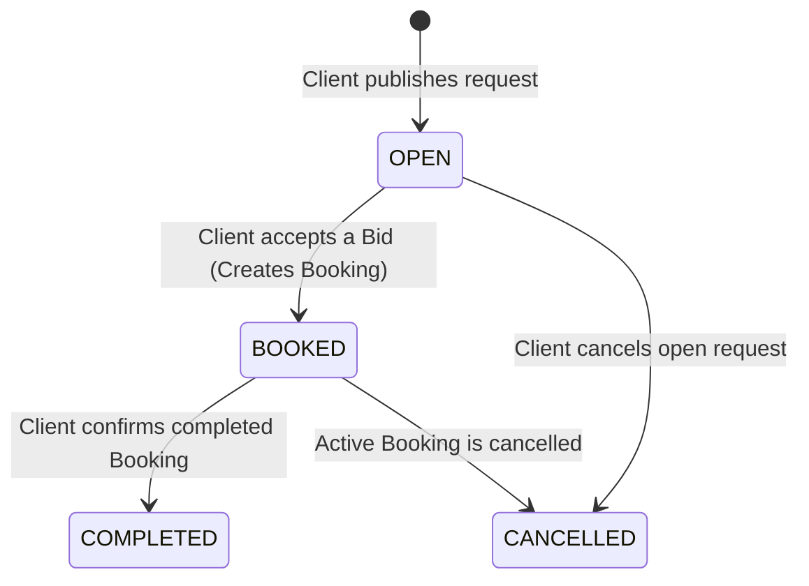
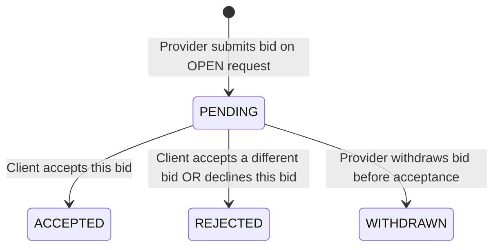
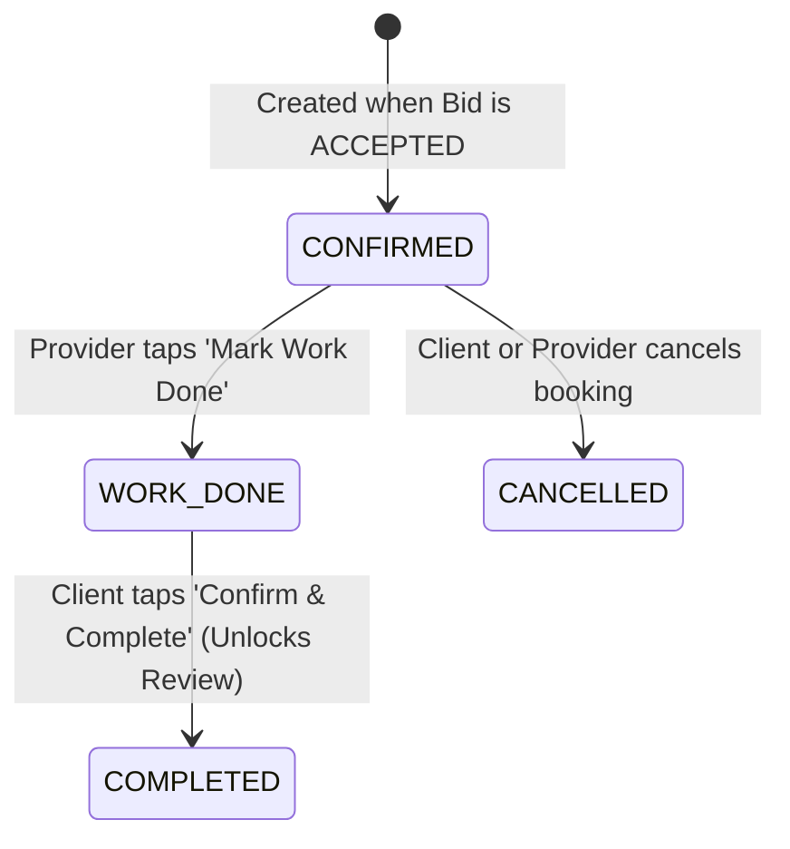

# Domain & Data Model (`service_platform`)

This document defines the canonical data entities, fields, status enums, and state transitions for the mobile app and cloud database.

---

## 1. Entities & Field Definitions

### 1.1 `AppUser`
Represents an authenticated user account.
- `id` (`String`, PK — Cloud Auth UID)
- `full_name` (`String`, required)
- `email` (`String`, required)
- `phone` (`String`, required)
- `city` (`String`, default `"Lahore"`)
- `avatar_url` (`String?`, optional)
- `active_role` (`Enum: CLIENT | PROVIDER`, default `CLIENT`)
- `is_provider_onboarded` (`Boolean`, default `false`)
- `created_at` (`Timestamp`)

### 1.2 `ProviderProfile`
Stores provider skills, bio, and rating summary (1-to-1 with `AppUser` once onboarded).
- `user_id` (`String`, PK / FK -> `AppUser.id`)
- `display_name` (`String`, required)
- `bio` (`String`, required)
- `categories` (`List<String>`, e.g., `["Electrical", "AC Repair"]`)
- `city` (`String`, required)
- `service_areas` (`List<String>`, e.g., `["Johar Town", "DHA", "Gulberg"]`)
- `is_available` (`Boolean`, default `true`)
- `rating_average` (`Double`, default `0.0`)
- `review_count` (`Int`, default `0`)
- `completed_bookings_count` (`Int`, default `0`)
- `updated_at` (`Timestamp`)

### 1.3 `ServiceRequest`
Created by a Client when requesting a service.
- `id` (`String`, PK)
- `client_id` (`String`, FK -> `AppUser.id`)
- `client_name` (`String`)
- `title` (`String`, required, 5–80 chars)
- `category` (`Enum: ELECTRICAL | PLUMBING | AC_REPAIR | CLEANING | CARPENTRY | PAINTING | HANDYMAN`)
- `description` (`String`, required, 10–1000 chars)
- `city` (`String`, required)
- `area_name` (`String`, required — neighborhood/sector shown on feed)
- `address_details` (`String`, required — street/house details shown after booking is confirmed)
- `budget_pkr` (`Double?`, optional indicative budget)
- `photo_urls` (`List<String>`, max 3 URLs)
- `status` (`Enum: OPEN | BOOKED | COMPLETED | CANCELLED`, default `OPEN`)
- `bid_count` (`Int`, default `0`)
- `created_at` (`Timestamp`)

### 1.4 `Bid`
A quote submitted by a Provider on an `OPEN` `ServiceRequest`.
- `id` (`String`, PK)
- `request_id` (`String`, FK -> `ServiceRequest.id`)
- `provider_id` (`String`, FK -> `ProviderProfile.user_id`)
- `provider_name` (`String`)
- `provider_rating` (`Double`)
- `proposed_price` (`Double`, required, > 0)
- `message` (`String`, required)
- `status` (`Enum: PENDING | ACCEPTED | REJECTED | WITHDRAWN`, default `PENDING`)
- `created_at` (`Timestamp`)
- *Rule*: One active bid per `(request_id, provider_id)`, and `provider_id != request.client_id`.

### 1.5 `Booking`
Created immediately when a Client accepts a `PENDING` `Bid`.
- `id` (`String`, PK)
- `request_id` (`String`, FK -> `ServiceRequest.id`, unique)
- `bid_id` (`String`, FK -> `Bid.id`)
- `client_id` (`String`, FK -> `AppUser.id`)
- `provider_id` (`String`, FK -> `ProviderProfile.user_id`)
- `agreed_price` (`Double`)
- `status` (`Enum: CONFIRMED | WORK_DONE | COMPLETED | CANCELLED`, default `CONFIRMED`)
- `cancelled_by` (`Enum: CLIENT | PROVIDER?`, nullable)
- `created_at` (`Timestamp`)
- `completed_at` (`Timestamp?`, nullable)

### 1.6 `ChatMessage`
Messages inside a `Booking` conversation.
- `id` (`String`, PK)
- `booking_id` (`String`, FK -> `Booking.id`)
- `sender_id` (`String`, FK -> `AppUser.id`)
- `sender_name` (`String`)
- `text` (`String`, required)
- `created_at` (`Timestamp`)

### 1.7 `Review`
Client rating submitted after a `Booking` reaches `COMPLETED`.
- `id` (`String`, PK)
- `booking_id` (`String`, FK -> `Booking.id`, unique)
- `request_id` (`String`, FK -> `ServiceRequest.id`)
- `client_id` (`String`, FK -> `AppUser.id`)
- `client_name` (`String`)
- `provider_id` (`String`, FK -> `ProviderProfile.user_id`)
- `rating` (`Int`, `1..5`)
- `comment` (`String?`, optional)
- `created_at` (`Timestamp`)

---

## 2. State Transition Diagrams

### 2.1 `ServiceRequest` Lifecycle

### 2.2 `Bid` Lifecycle

### 2.3 `Booking` Lifecycle

