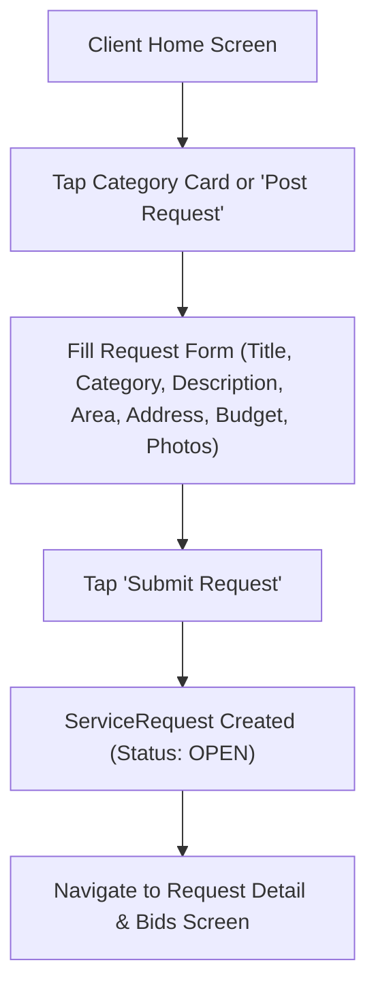
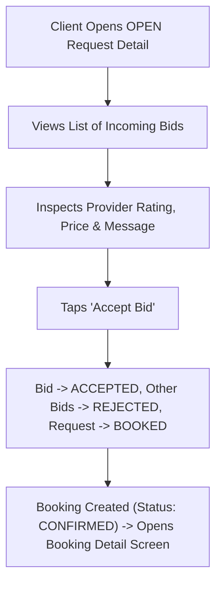
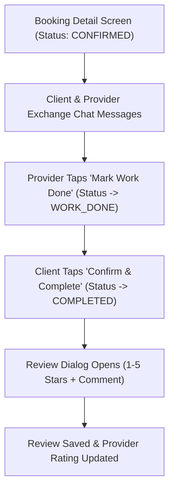

# User Flows & Screen Specifications (`service_platform`)

This document specifies the screen inventory, navigation structure, and user flows for the **Service Platform** Flutter application.

---

## 1. Navigation Shell

### 1.1 Client Mode Bottom Navigation (`active_role == CLIENT`)
1. **Home (`ClientHomeScreen`)**: Category cards, recent requests banner, and **Post a Service Request** CTA button.
2. **My Requests (`MyRequestsScreen`)**: Tabs for `Open`, `Booked`, and `Completed / Cancelled`.
3. **Bookings & Chat (`ClientBookingsScreen`)**: List of active and past bookings with quick entry to chat.
4. **Profile (`ProfileScreen`)**: User details and **Switch to Provider Mode** button.

### 1.2 Provider Mode Bottom Navigation (`active_role == PROVIDER`)
1. **Explore Requests (`ProviderFeedScreen`)**: Feed of `OPEN` service requests with category and city filter chips.
2. **My Bids (`ProviderBidsScreen`)**: List of submitted bids (`PENDING`, `ACCEPTED`, `REJECTED`).
3. **Active Bookings (`ProviderBookingsScreen`)**: Confirmed jobs, client address view, chat, and **Mark Work Done** button.
4. **Provider Profile (`ProviderProfileScreen`)**: Bio, categories, rating summary, reviews list, and **Switch to Client Mode** button.

---

## 2. Client User Flows

### Flow C1: Posting a Service Request

- **Form Validations**:
  - `title`: Required, `5–80` characters.
  - `category`: Required dropdown/grid selection.
  - `description`: Required, `10–1000` characters.
  - `city` & `area_name`: Required (shown publicly on provider feed).
  - `address_details`: Required (revealed only inside the `Booking` screen after a bid is accepted).
  - `budget_pkr`: Optional positive number.
  - `photos`: Up to `3` images from gallery or camera.

---

### Flow C2: Comparing Bids & Creating a Booking

---

### Flow C3: Chat, Confirming Completion & Leaving a Review

---

## 3. Provider User Flows

### Flow P1: Provider Onboarding
1. User taps **Switch to Provider Mode** in the `Profile` tab.
2. If `is_provider_onboarded == false`, displays `ProviderOnboardingScreen`:
   - Enter `display_name` and `bio`.
   - Select one or more service `categories`.
   - Enter `city` and `service_areas`.
3. Saves `ProviderProfile` (`is_provider_onboarded = true`) and opens the Provider navigation shell.

### Flow P2: Browsing Open Requests & Submitting a Bid
1. On `ProviderFeedScreen`, provider browses `OPEN` requests (excluding requests where `client_id == currentUser.id`).
2. Tapping a request opens `ProviderRequestDetailScreen` showing title, description, category, `area_name, city`, indicative budget, and photos.
3. Provider taps **Submit Bid**, enters `proposed_price` (PKR) and `message`, and submits (`Bid.status = PENDING`).

### Flow P3: Executing Booking & Marking Work Done
1. When a Client accepts the bid, the booking appears in `ProviderBookingsScreen` (`status = CONFIRMED`).
2. Opening the booking reveals the Client's `address_details`, phone, agreed price, and the in-app **Chat** button.
3. Once the work is finished, the Provider taps **Mark Work Done**, updating `Booking.status` to `WORK_DONE` so the Client can confirm completion.
